# 2025-2026（二）《设计模式》课程设计报告

**班级**：___信计232___ ; **姓名**：____钟泽鑫__； **学号**：___202321024232___

**报告说明**：本报告基于设计模式课程要求，涵盖 NPC Agent 游戏智能行为决策系统的全流程设计与实现，详细阐述了 10 种 GoF 设计模式在项目中的应用实践。

**适用场景**：基于设计模式、AI Agent、系统开发的课程设计项目

---

# 一、课程设计自评

## 1.1 自评分数

**自评总分**：90分

**打分说明**：

| 维度 | 得分 | 说明 |
|------|------|------|
| 功能完成度（30分） | 28分 | 7种状态、5种策略、毒雾系统、对话系统等核心功能全部实现，UI显示效果良好，仅行为树模块保留架构未启用 |
| 技术应用与设计模式落地（30分） | 28分 | 10种GoF设计模式完整落地，装饰器模式（毒雾）、状态模式（行为决策）、观察者模式（事件总线）等核心模式应用得当，架构设计符合开闭原则 |
| 代码优化与迭代重构（20分） | 18分 | 通过多次迭代消除了硬编码、模块耦合、状态切换频繁等问题，代码结构清晰，模块职责明确 |
| 报告撰写完整性（20分） | 16分 | 报告覆盖项目全流程，设计模式角色映射清晰，但缺少部分测试截图和详细运行展示 |

## 1.2 整体自我评价

本次课程设计投入了大量时间进行需求分析、架构设计和代码实现。在需求分析阶段，通过梳理 NPC 智能行为的核心需求，明确了状态机、策略系统、感知系统等核心模块的功能边界。在架构设计阶段，深入研究了 GoF 设计模式的适用场景，结合游戏 AI 的特点选择了状态模式、策略模式、装饰器模式等核心模式进行组合应用。

在代码开发过程中，严格遵循设计模式的设计原则，确保新增功能通过扩展而非修改现有代码实现。通过多次迭代重构，解决了模块耦合、状态切换频繁、Tkinter线程安全等问题，提升了代码质量和系统稳定性。

在问题排查方面，通过日志记录和调试工具定位了多个关键问题，如"Vector2"对象无health属性、多个守卫同时警戒、状态切换延迟等，积累了丰富的调试经验。

文档撰写方面，参考架构设计总结文档，详细阐述了各设计模式的应用场景、角色映射和代码实现，但在测试截图和运行展示方面有待完善。

---

# 二、绪论

## 2.1 项目开发背景

随着游戏产业的快速发展，NPC（非玩家角色）的智能行为越来越受到重视。传统的 NPC 行为控制方式（如有限状态机、脚本驱动）存在扩展性差、维护困难等问题，难以满足现代游戏对 NPC 行为多样性和复杂性的需求。

在课程学习过程中，我们深入学习了 GoF（Gang of Four）23 种设计模式，这些模式为解决软件设计中的常见问题提供了成熟的解决方案。本项目旨在将设计模式应用于 NPC 智能行为决策系统的开发中，验证设计模式在实际项目中的有效性和适用性。

## 2.2 项目开发意义

**理论意义**：

- 验证设计模式在游戏 AI 领域的应用价值，加深对设计模式核心思想的理解
- 探索设计模式组合应用的最佳实践，为复杂系统的架构设计提供参考
- 研究 AI Agent 分层架构的工程实现，为后续相关领域的学习和研究奠定基础

**实践意义**：

- 开发一套可扩展、可维护的 NPC 智能行为决策系统，可作为游戏开发的基础组件
- 实现毒雾系统、对话系统、感知系统等核心功能，提升游戏的趣味性和交互性
- 通过实际项目实践，积累软件工程开发经验，提升代码质量和架构设计能力

## 2.3 国内外研究与应用现状

在游戏 AI 领域，NPC 行为决策系统的研究和应用已经非常广泛。国外方面，Unity、Unreal Engine 等主流游戏引擎都提供了完善的 AI 开发工具，如行为树、状态机编辑器等。国内方面，随着游戏产业的快速发展，越来越多的游戏公司开始重视 NPC 智能行为的开发，但在设计模式的应用和架构设计方面仍有提升空间。

现有方案的优势在于功能完善、工具成熟，但存在以下不足：
- 设计模式应用不够深入，代码耦合度较高
- 扩展性不足，新增状态或策略需要修改大量现有代码
- 缺乏对装饰器模式等高级模式的应用，难以实现横向正交功能（如中毒、减速等效果叠加）

本项目针对以上不足，通过深入应用设计模式，特别是装饰器模式、状态模式和策略模式，实现了 NPC 行为决策系统的高度解耦和灵活扩展。

## 2.4 项目开发目标

**功能实现目标**：

- 实现 NPC 多状态自主行为决策（7种状态：警戒、巡逻、对话、招揽、整理货物、休息、中毒）
- 实现不同类型 NPC 的行为策略切换（5种策略：攻击型、防御型、逃跑型、巡逻型、商人型）
- 实现毒雾系统，支持中毒效果叠加和自动恢复
- 实现对话系统，支持 NPC-玩家交互
- 实现感知系统，支持距离检测和注意力过滤

**技术应用目标**：

- 应用 10 种 GoF 设计模式，验证模式组合应用的有效性
- 实现 AI Agent 分层架构，确保模块解耦和独立迭代
- 遵循开闭原则，新增功能通过扩展而非修改现有代码实现

**架构设计目标**：

- 设计清晰的分层架构，明确各模块职责边界
- 实现事件驱动的模块通信机制，降低模块耦合度
- 提供统一的接口和抽象，便于后续功能扩展和重构

**学习实践目标**：

- 掌握设计模式的核心思想和应用场景
- 提升架构设计能力和代码质量意识
- 积累游戏 AI 开发经验，了解游戏开发的核心流程

## 2.5 主要工作与论文结构

**主要工作**：

1. **需求分析**：梳理 NPC 智能行为决策系统的核心需求，明确功能边界和非功能性要求
2. **技术选型**：选择 Python + Tkinter 作为开发工具，确定设计模式应用方案
3. **架构设计**：设计分层架构，划分模块职责，确定各模块间的协作关系
4. **模块开发**：实现状态机、策略系统、感知系统、命令系统等核心模块
5. **代码实现**：编写各模块的具体代码，确保设计模式的正确应用
6. **重构优化**：通过迭代重构消除代码冗余和模块耦合，提升代码质量
7. **测试调试**：编写测试用例，验证系统功能的正确性和稳定性
8. **问题解决**：解决开发过程中遇到的技术问题和架构问题

**论文结构**：

本报告共分为十章：
- 第一章：课程设计自评
- 第二章：绪论
- 第三章：相关技术与理论基础
- 第四章：系统需求分析
- 第五章：系统总体设计
- 第六章：系统实现
- 第七章：系统测试
- 第八章：总结与展望
- 第九章：开发问题与解决方案复盘
- 第十章：AI辅助开发提示词清单

---

# 三、相关技术与理论基础

## 3.1 开发环境与工具

| 工具类型 | 工具名称 | 版本 | 选型原因 |
|---------|---------|------|---------|
| 编程语言 | Python | 3.9+ | 语法简洁，适合快速开发，支持面向对象编程 |
| 开发IDE | VS Code | 最新版 | 轻量级、插件丰富，支持 Python 开发 |
| GUI框架 | Tkinter | 内置 | Python 标准库，无需额外安装，适合快速构建原型 |
| 辅助工具 | XMind | 最新版 | 用于绘制思维导图和架构图 |
| 辅助工具 | Visio | 最新版 | 用于绘制类图和时序图 |

## 3.2 核心技术原理

### 3.2.1 AI Agent 分层架构

AI Agent 通常分为感知层、决策层和行动层三个核心层次：

- **感知层（Perception）**：负责获取环境信息，如玩家位置、敌人状态、物品位置等
- **决策层（Decision）**：根据感知信息和内部状态做出行为决策，如状态转换、策略选择等
- **行动层（Action）**：执行决策结果，如移动、攻击、对话等

本项目采用这一经典架构，通过设计模式实现各层的解耦和协作。

### 3.2.2 状态机原理

状态机是一种描述对象行为的数学模型，由状态、事件和转换组成。在游戏 AI 中，状态机广泛用于描述 NPC 的行为模式：

- **状态（State）**：NPC 当前的行为模式，如巡逻、警戒、战斗等
- **事件（Event）**：触发状态转换的条件，如发现玩家、失去目标等
- **转换（Transition）**：从一个状态到另一个状态的变化

本项目通过状态模式实现状态机，每种状态封装自己的行为和转换条件，符合开闭原则。

### 3.2.3 策略模式原理

策略模式将算法封装成独立的策略类，使得算法可以独立于使用算法的对象变化。在游戏 AI 中，策略模式用于实现不同类型 NPC 的行为差异：

- **策略（Strategy）**：行为算法的抽象表示
- **具体策略（ConcreteStrategy）**：具体的行为算法实现
- **上下文（Context）**：使用策略的对象

本项目通过策略模式实现守卫、商人等不同类型 NPC 的行为差异。

## 3.3 核心设计模式详解

### 3.3.1 状态模式（State Pattern）

**核心原理**：状态模式定义了对象行为与其状态之间的关系，当对象的内部状态改变时，其行为也随之改变。

**结构角色**：

| 角色 | 职责 |
|------|------|
| **Context（上下文）** | 维护当前状态，委托状态对象处理请求 |
| **AbstractState（抽象状态）** | 定义状态的接口，声明处理请求的方法 |
| **ConcreteState（具体状态）** | 实现抽象状态接口，处理特定状态下的请求 |

**适用场景**：

- 对象的行为依赖于其状态，且在运行时状态会发生变化
- 代码中包含大量与状态相关的条件语句（if-else 或 switch-case）
- 需要将状态相关的行为封装起来，提高代码的可维护性和可扩展性

**项目适配性**：

NPC 行为天然具有多状态特性，使用状态模式可以将每种状态的行为和转换条件封装到独立的类中，避免 if-else 堆砌，符合开闭原则。

### 3.3.2 策略模式（Strategy Pattern）

**核心原理**：策略模式定义了一系列算法，将每个算法封装起来，并使它们可以互相替换。

**结构角色**：

| 角色 | 职责 |
|------|------|
| **Context（上下文）** | 使用策略的对象，维护对策略对象的引用 |
| **Strategy（抽象策略）** | 定义策略的接口，声明算法方法 |
| **ConcreteStrategy（具体策略）** | 实现抽象策略接口，提供具体的算法实现 |

**适用场景**：

- 需要在运行时动态切换算法
- 有多种相似的算法，只是实现细节不同
- 算法的实现不应该影响使用算法的客户端代码

**项目适配性**：

不同类型 NPC 的行为算法不同（守卫攻击、商人招揽等），使用策略模式可以将行为算法与 NPC 实体解耦，支持运行时动态切换策略。

### 3.3.3 装饰器模式（Decorator Pattern）

**核心原理**：装饰器模式动态地给对象添加额外的职责，就像给对象穿上一层层外衣。

**结构角色**：

| 角色 | 职责 |
|------|------|
| **Component（抽象组件）** | 定义对象的接口，可以给这些对象动态添加职责 |
| **ConcreteComponent（具体组件）** | 实现抽象组件接口，是被装饰的对象 |
| **Decorator（抽象装饰器）** | 持有对组件对象的引用，并定义与抽象组件一致的接口 |
| **ConcreteDecorator（具体装饰器）** | 实现抽象装饰器接口，添加具体的装饰职责 |

**适用场景**：

- 需要动态地给对象添加功能，且这些功能可以撤销
- 当不能通过继承来扩展对象功能时（如类定义为 final）
- 需要给一组对象添加不同的功能，避免使用大量的子类组合

**项目适配性**：

中毒是一个横向正交状态，可以叠加在任何普通状态之上。使用装饰器模式可以在不修改原有状态代码的情况下，为状态添加中毒效果（减速、禁休息等）。

### 3.3.4 观察者模式（Observer Pattern）

**核心原理**：观察者模式定义了对象之间的一对多依赖关系，当一个对象状态改变时，所有依赖者都会收到通知并自动更新。

**结构角色**：

| 角色 | 职责 |
|------|------|
| **Subject（主题）** | 维护观察者列表，提供订阅和取消订阅的方法，通知所有观察者 |
| **Observer（观察者）** | 定义接收通知的接口 |
| **ConcreteObserver（具体观察者）** | 实现观察者接口，处理收到的通知 |

**适用场景**：

- 当一个对象的改变需要同时改变其他对象，且不知道具体有多少对象需要改变时
- 当一个对象必须通知其他对象，又不能假定其他对象是谁时
- 需要在系统中创建一个触发链，对象的行为会影响其他对象

**项目适配性**：

事件总线需要在模块间建立松耦合的通信机制，使用观察者模式可以实现事件的发布-订阅，避免模块间的直接依赖。

### 3.3.5 命令模式（Command Pattern）

**核心原理**：命令模式将请求封装为对象，从而可以用不同的请求、队列或日志来参数化其他对象。

**结构角色**：

| 角色 | 职责 |
|------|------|
| **Command（命令）** | 声明执行操作的接口 |
| **ConcreteCommand（具体命令）** | 实现命令接口，绑定接收者并调用其方法 |
| **Invoker（调用者）** | 请求发送者，调用命令对象执行请求 |
| **Receiver（接收者）** | 命令的实际执行者 |

**适用场景**：

- 需要将请求发送者和执行者解耦
- 需要支持请求的排队执行、日志记录、撤销/重做等功能
- 需要将操作参数化，以便使用不同的请求

**项目适配性**：

NPC 的动作（移动、攻击、对话等）需要支持队列执行和撤销/重做，使用命令模式可以将动作封装为命令对象，实现灵活的动作管理。

### 3.3.6 工厂方法模式（Factory Method Pattern）

**核心原理**：工厂方法模式定义了一个创建对象的接口，让子类决定实例化哪一个类。

**结构角色**：

| 角色 | 职责 |
|------|------|
| **Creator（抽象创建者）** | 声明工厂方法，返回产品对象 |
| **ConcreteCreator（具体创建者）** | 实现工厂方法，返回具体产品对象 |
| **Product（抽象产品）** | 定义产品的接口 |
| **ConcreteProduct（具体产品）** | 实现产品接口 |

**适用场景**：

- 当创建对象的过程比较复杂，需要封装创建逻辑时
- 当需要将创建逻辑与使用逻辑解耦时
- 当需要支持多种产品类型，且产品类型可以扩展时

**项目适配性**：

NPC 对象的创建需要涉及状态机初始化、策略配置等复杂逻辑，使用工厂方法模式可以将创建逻辑封装到工厂类中，提高代码的可维护性。

### 3.3.7 组合模式（Composite Pattern）

**核心原理**：组合模式允许将对象组合成树形结构来表示"部分-整体"的层次结构。

**结构角色**：

| 角色 | 职责 |
|------|------|
| **Component（抽象组件）** | 定义组合对象和叶对象的公共接口 |
| **Composite（组合节点）** | 包含子节点，可以是组合节点或叶节点 |
| **Leaf（叶节点）** | 没有子节点，是树形结构的末端 |

**适用场景**：

- 需要表示对象的部分-整体层次结构
- 希望客户端以统一的方式处理组合对象和单个对象
- 需要动态地添加或删除组合中的对象

**项目适配性**：

行为树需要组织成树形结构，包含选择器、序列器等组合节点和条件、动作等叶节点，使用组合模式可以统一处理不同类型的节点。

### 3.3.8 外观模式（Facade Pattern）

**核心原理**：外观模式为子系统中的一组接口提供一个统一的高层接口，使得子系统更容易使用。

**结构角色**：

| 角色 | 职责 |
|------|------|
| **Facade（外观）** | 提供统一的高层接口，封装子系统的复杂性 |
| **Subsystem（子系统）** | 一组相关的接口或类，实现具体的功能 |

**适用场景**：

- 当子系统变得复杂，需要简化接口时
- 当需要为子系统提供统一的入口时
- 当需要降低客户端与子系统之间的耦合度时

**项目适配性**：

AI 子系统包含状态机、策略执行器、行为树等多个组件，使用外观模式可以提供统一的入口（NPCBrain），简化客户端的使用。

### 3.3.9 单例模式（Singleton Pattern）

**核心原理**：单例模式确保一个类只有一个实例，并提供一个全局访问点。

**结构角色**：

| 角色 | 职责 |
|------|------|
| **Singleton（单例类）** | 确保只有一个实例，提供全局访问点 |

**适用场景**：

- 当系统中需要一个唯一的对象来协调多个模块时
- 当需要控制资源的访问，避免多个实例竞争时
- 当需要全局共享状态时

**项目适配性**：

事件总线需要全局唯一实例，确保所有模块订阅/发布的是同一个事件中心，使用单例模式可以保证这一点。


---

# 四、系统需求分析

## 4.1 功能性需求

### 4.1.1 NPC 状态机

| 功能点 | 输入 | 输出 | 执行逻辑 | 业务作用 |
|--------|------|------|---------|---------|
| 状态切换 | 当前状态、感知结果 | 新状态 | 根据感知结果和转换条件判断是否需要切换状态 | 实现 NPC 行为的动态变化 |
| 状态行为执行 | 当前状态、NPC 上下文 | 动作输出 | 执行当前状态对应的行为（巡逻、追逐等） | 实现 NPC 的具体行为 |
| 中毒状态叠加 | NPC 进入毒雾区域 | 中毒状态包装原状态 | 检测 NPC 是否在毒雾中，若是则用 PoisonedState 包装当前状态 | 实现中毒效果的叠加 |
| 中毒状态恢复 | NPC 离开毒雾区域、恢复时间 | 解除中毒，返回原状态 | 离开毒雾后计时，3秒后解除中毒装饰 | 实现中毒效果的自动恢复 |

### 4.1.2 策略系统

| 功能点 | 输入 | 输出 | 执行逻辑 | 业务作用 |
|--------|------|------|---------|---------|
| 策略切换 | 状态进入、NPC 类型 | 新策略 | 根据状态和 NPC 类型选择合适的策略 | 实现不同状态和角色的行为差异 |
| 策略评估 | NPC 上下文 | 策略优先级 | 评估当前策略的优先级 | 支持策略的动态选择 |
| 动作选择 | 策略、感知结果 | 具体动作 | 根据策略和感知结果选择要执行的动作 | 将决策转换为具体行动 |

### 4.1.3 感知系统

| 功能点 | 输入 | 输出 | 执行逻辑 | 业务作用 |
|--------|------|------|---------|---------|
| 距离检测 | NPC 位置、玩家位置 | 距离 | 计算 NPC 与玩家之间的欧几里得距离 | 判断玩家是否在 NPC 的感知范围内 |
| 注意力过滤 | 距离、注意力半径 | 感知结果 | 判断距离是否在注意力半径内 | 避免无关 NPC 响应感知事件 |
| 置信度衰减 | 距离、衰减系数 | 置信度 | 根据距离计算感知置信度 | 实现更真实的感知效果 |

### 4.1.4 对话系统

| 功能点 | 输入 | 输出 | 执行逻辑 | 业务作用 |
|--------|------|------|---------|---------|
| 对话触发 | 玩家与 NPC 交互 | 进入对话状态 | 检测玩家是否与 NPC 交互，若是则进入对话状态 | 实现 NPC-玩家交互 |
| 对话选项显示 | 对话树数据 | 对话选项 | 根据对话树显示当前可用的对话选项 | 提供交互式对话体验 |
| 对话推进 | 玩家选择的选项 | 下一段对话 | 根据玩家选择推进对话树 | 实现对话的分支和推进 |

### 4.1.5 命令系统

| 功能点 | 输入 | 输出 | 执行逻辑 | 业务作用 |
|--------|------|------|---------|---------|
| 命令入队 | 动作请求 | 命令队列 | 将动作封装为命令对象加入队列 | 支持动作的排队执行 |
| 命令执行 | 命令队列 | 动作执行结果 | 依次执行队列中的命令 | 实现动作的有序执行 |
| 命令撤销 | 已执行命令历史 | 撤销结果 | 调用命令的 undo 方法恢复状态 | 支持动作的撤销 |

## 4.2 非功能性需求

### 4.2.1 性能需求

- 系统运行流畅，帧率稳定在 30 FPS 以上
- NPC 数量增加到 10 个时，系统响应时间不超过 50ms
- 毒雾区域检测和感知计算每帧耗时不超过 10ms

### 4.2.2 可扩展性需求

- 新增状态或策略无需修改现有代码，只需添加新类和注册
- 支持多种设备类型和渲染后端的扩展
- 模块间耦合度低，便于独立开发和测试

### 4.2.3 可维护性需求

- 代码结构清晰，模块职责明确
- 命名规范统一，注释完善
- 设计模式应用得当，符合开闭原则

### 4.2.4 易用性需求

- 提供一键启动脚本，简化项目运行流程
- UI 界面简洁明了，状态显示清晰
- 支持玩家通过键盘控制角色移动

## 4.3 业务流程分析

### 4.3.1 NPC 行为决策流程

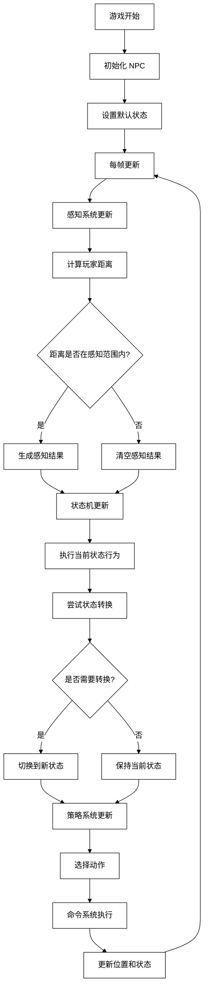

### 4.3.2 毒雾系统流程

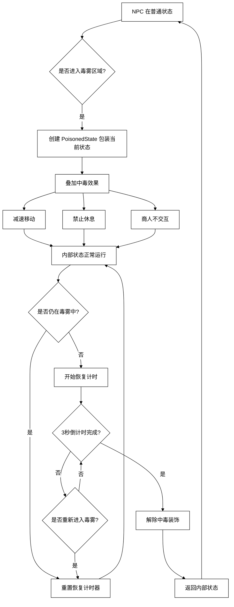

### 4.3.3 对话交互流程

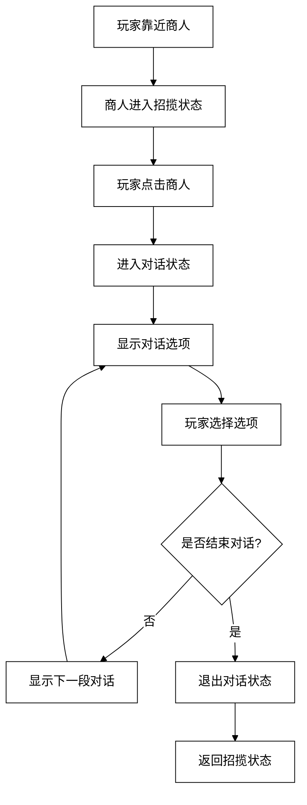

---

# 五、系统总体设计

## 5.1 系统架构设计

本项目采用 **分层架构**，自下而上分为核心层、工具层、AI Agent 层、业务层和表现层五个层次：

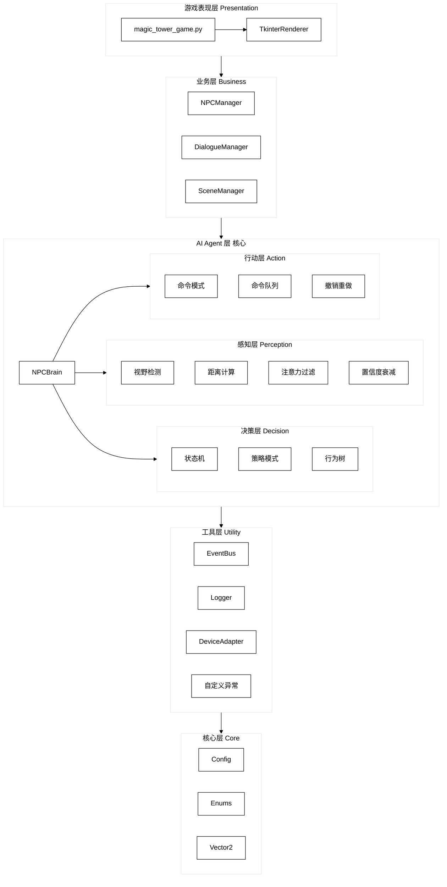

**分层设计思路**：

- **核心层**：提供基础数据结构和配置管理，是整个系统的基石
- **工具层**：提供通用工具和基础设施，如事件总线、日志系统、设备适配等
- **AI Agent 层**：实现 NPC 智能行为的核心逻辑，包括感知、决策和行动三个子层
- **业务层**：管理游戏业务逻辑，如 NPC 创建、对话管理、场景管理等
- **表现层**：负责游戏的可视化和用户交互，包括渲染和输入处理

**协作关系**：

表现层通过业务层与 AI Agent 层交互，AI Agent 层通过工具层获取基础设施服务，工具层依赖核心层的基础组件。这种分层架构确保了模块间的低耦合和高内聚，便于独立开发和迭代。

## 5.2 系统模块划分

### 5.2.1 模块划分原则

1. **单一职责原则**：每个模块只负责一个功能领域
2. **高内聚低耦合**：模块内部高度内聚，模块间尽量低耦合
3. **接口隔离**：通过接口定义模块间的交互，避免直接依赖具体实现
4. **开闭原则**：模块对扩展开放，对修改关闭

### 5.2.2 核心模块列表

| 模块名称 | 所属层次 | 职责描述 | 核心类/文件 |
|---------|---------|---------|------------|
| **状态机模块** | AI Agent 层 - 决策 | 实现 NPC 多状态行为决策和转换 | `IState`、`NPCContext`、`AlertState` 等 |
| **策略模块** | AI Agent 层 - 决策 | 实现不同类型 NPC 的行为算法切换 | `IStrategy`、`StrategyExecutor`、`AggressiveStrategy` 等 |
| **感知模块** | AI Agent 层 - 感知 | 实现 NPC 对环境的感知和注意力过滤 | `PerceptionComponent` |
| **命令模块** | AI Agent 层 - 行动 | 实现 NPC 动作的封装、队列执行和撤销 | `ICommand`、`CommandQueue`、`MoveCommand` 等 |
| **行为树模块** | AI Agent 层 - 决策 | 实现基于组合模式的行为树（保留架构） | `IBTNode`、`BTSelector`、`BTSequence` 等 |
| **事件总线模块** | 工具层 | 实现模块间松耦合通信 | `EventBus`、`IEventObserver` |
| **设备适配模块** | 工具层 | 实现不同设备的输入输出适配 | `IDeviceAdapter`、`PCAdapter` 等 |
| **NPC 管理模块** | 业务层 | 实现 NPC 对象的创建和管理 | `INPCFactory`、`NPCFactory`、`NPC` |
| **对话管理模块** | 业务层 | 实现对话树的管理和交互 | `DialogueManager` |
| **场景管理模块** | 业务层 | 实现场景的加载和管理 | `SceneManager` |
| **渲染模块** | 表现层 | 实现游戏画面的渲染 | `IGameRenderer`、`TkinterRenderer` |
| **配置模块** | 核心层 | 实现全局配置的管理 | `GameSettings`、`NPCConfig` |

### 5.2.3 模块调用关系

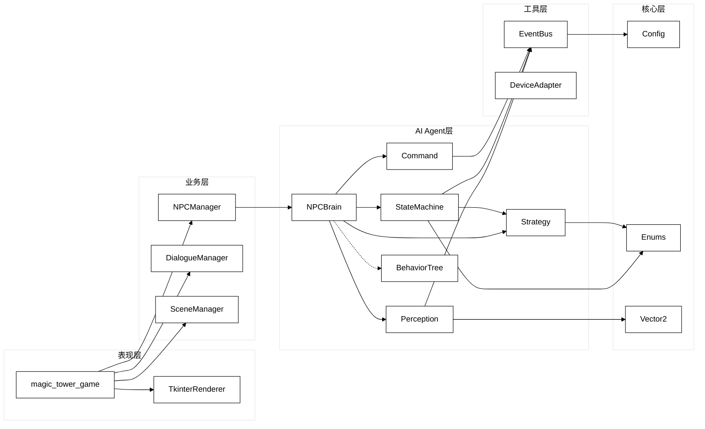

## 5.3 核心类图设计

### 5.3.1 状态模式类图

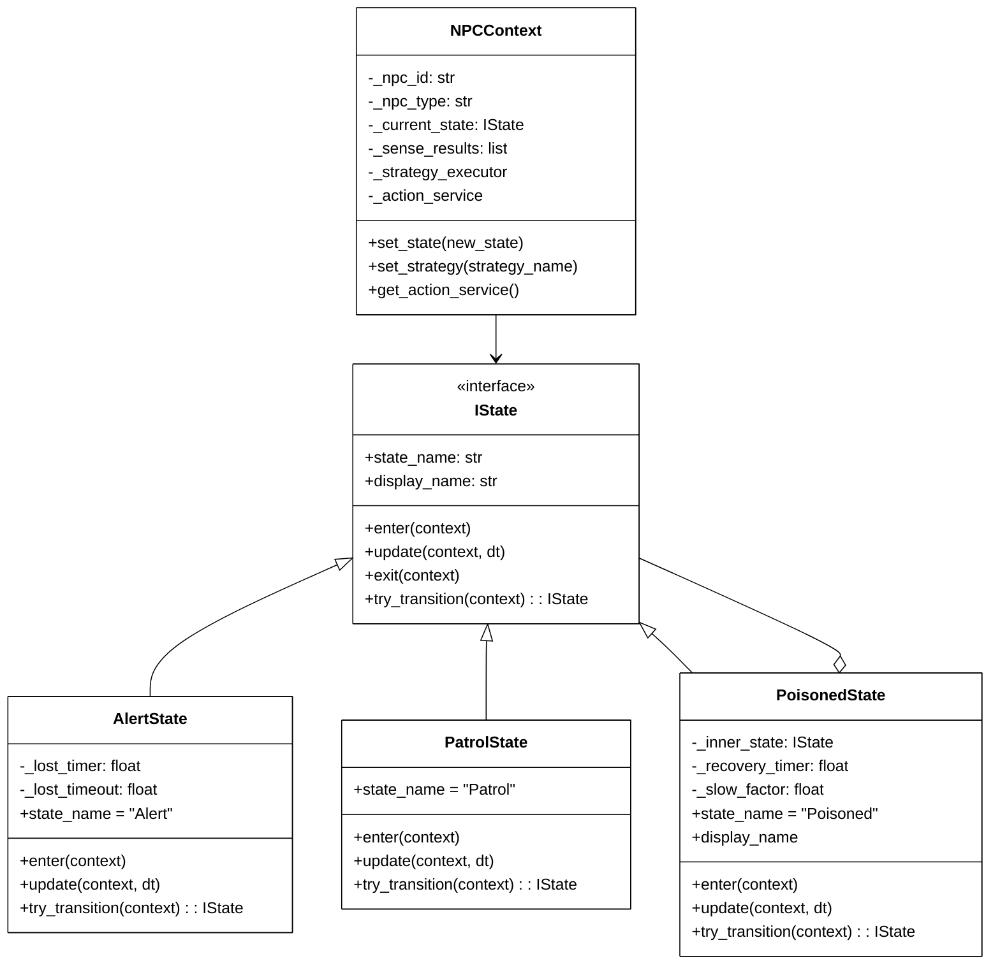

### 5.3.2 策略模式类图

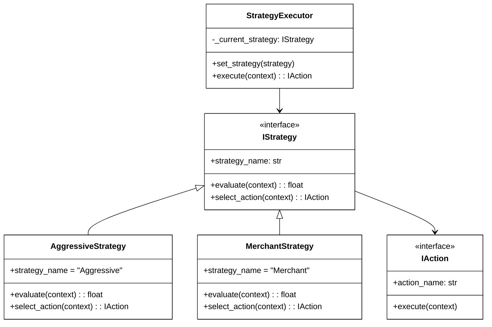

### 5.3.3 观察者模式类图

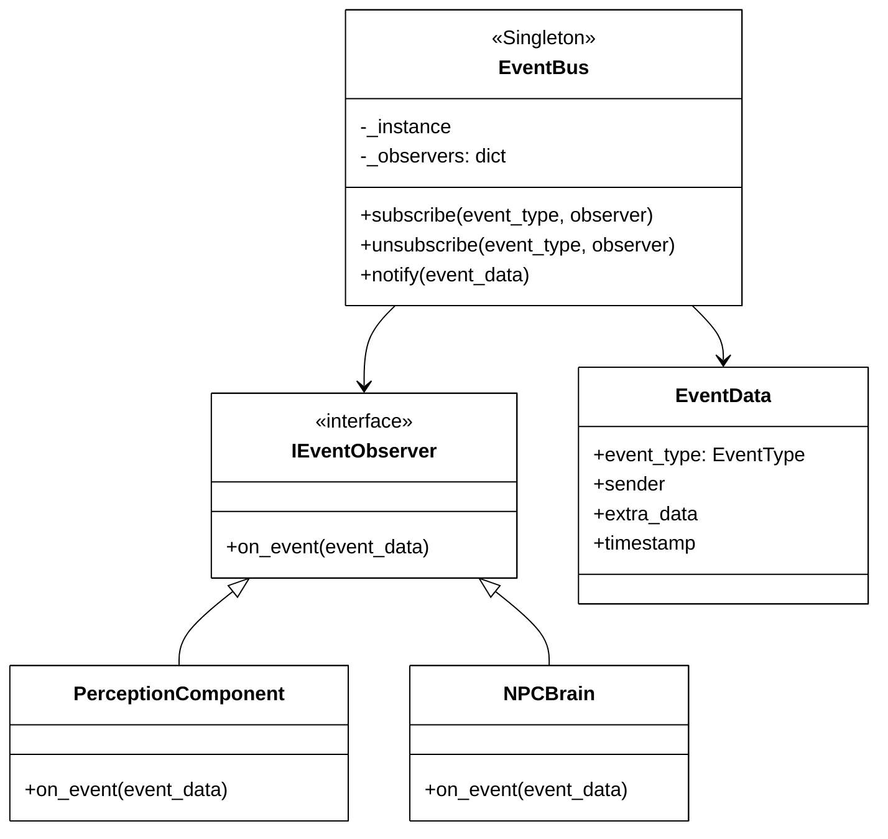

## 5.4 核心业务时序图

### 5.4.1 NPC 状态切换时序图

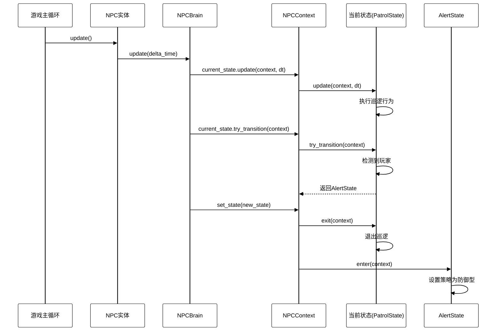

### 5.4.2 毒雾状态叠加时序图

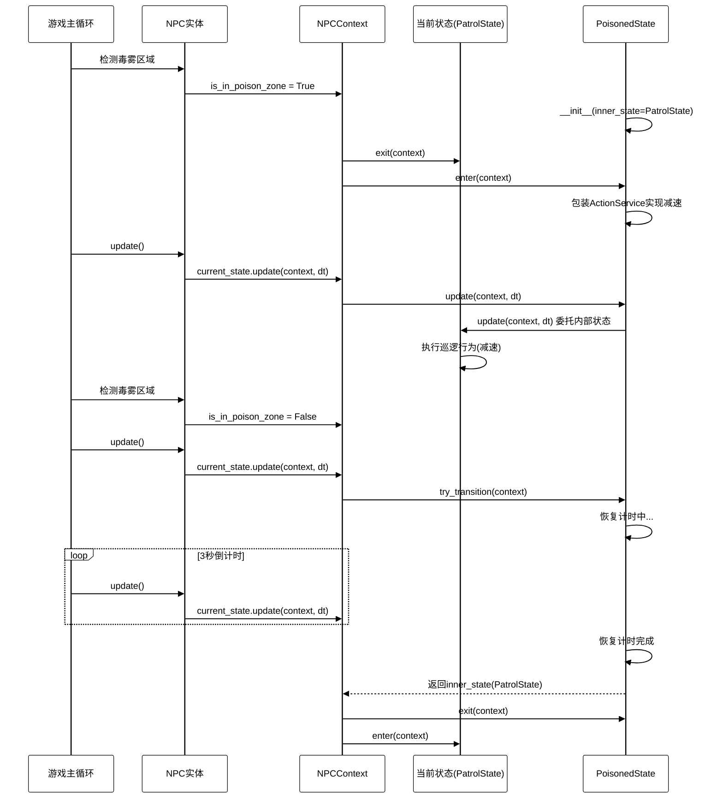

## 5.5 设计模式整体应用方案

### 5.5.1 设计模式协作链路

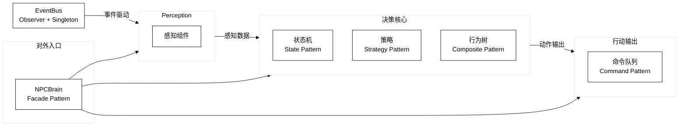

### 5.5.2 设计模式应用总结

| 设计模式 | 应用位置 | 核心作用 |
|---------|---------|---------|
| **状态模式** | 状态机模块 | 封装 NPC 多状态行为和转换条件 |
| **策略模式** | 策略模块 | 实现不同角色的行为算法切换 |
| **装饰器模式** | 毒雾系统 | 叠加中毒效果，不改变原状态行为 |
| **观察者模式** | 事件总线 | 实现模块间松耦合通信 |
| **命令模式** | 命令模块 | 封装动作，支持队列执行和撤销 |
| **工厂方法模式** | NPC 管理模块 | 封装 NPC 创建逻辑 |
| **组合模式** | 行为树模块 | 构建树形节点结构 |
| **外观模式** | NPCBrain | 统一 AI 子系统入口 |
| **单例模式** | EventBus | 确保全局事件总线唯一 |
| **适配器模式** | 设备适配和渲染模块 | 统一不同设备和渲染后端的接口 |

### 5.5.3 设计模式约束开发规范

1. **开闭原则**：新增状态、策略、命令等功能时，通过添加新类和注册实现，不修改现有代码
2. **依赖倒置**：模块间依赖抽象接口，不依赖具体实现
3. **接口隔离**：每个接口只包含客户端需要的方法，避免臃肿接口
4. **单一职责**：每个类只负责一个功能，职责清晰

---

# 六、系统实现

## 6.1 整体实现思路

### 6.1.1 开发实现思路

本项目采用**增量迭代开发**方式，按照以下顺序实现各模块：

1. **核心层**：实现配置管理、枚举定义、向量工具等基础组件
2. **工具层**：实现事件总线、日志系统、设备适配等基础设施
3. **AI Agent 层**：实现状态机、策略系统、感知系统、命令系统等核心模块
4. **业务层**：实现 NPC 管理、对话管理、场景管理等业务逻辑
5. **表现层**：实现渲染和用户交互

### 6.1.2 代码开发规范

- **命名规范**：类名使用 PascalCase，方法名和变量名使用 snake_case
- **接口规范**：接口类名以 `I` 开头，抽象方法使用 `@abstractmethod` 装饰器
- **设计模式规范**：严格遵循各设计模式的角色职责，确保模式应用正确
- **注释规范**：关键类和方法添加文档字符串，说明功能和参数

### 6.1.3 设计模式落地策略

1. **状态模式**：通过 `IState` 接口定义状态行为，每个具体状态类实现接口方法，`NPCContext` 维护当前状态
2. **策略模式**：通过 `IStrategy` 接口定义策略行为，每个具体策略类实现接口方法，`StrategyExecutor` 负责策略切换和执行
3. **装饰器模式**：`PoisonedState` 实现 `IState` 接口，内部持有 `inner_state` 引用，将方法委托给内部状态执行
4. **观察者模式**：`EventBus` 实现事件发布-订阅机制，`IEventObserver` 定义观察者接口
5. **命令模式**：`ICommand` 定义命令接口，具体命令类实现接口，`CommandQueue` 管理命令队列

## 6.2 核心模块实现

### 6.2.1 状态机模块实现

**功能定位**：实现 NPC 多状态行为决策和转换，是 AI Agent 的核心决策模块。

**实现流程**：

1. 定义 `IState` 接口，声明 `enter`、`update`、`exit`、`try_transition` 方法
2. 实现 `NPCContext` 上下文类，维护当前状态和状态切换逻辑
3. 实现各具体状态类（`AlertState`、`PatrolState`、`DialogState` 等），封装各自的行为和转换条件
4. 实现 `StateFactory` 简单工厂，根据状态名创建状态对象

**核心代码**：

```python
# IState 接口
class IState(ABC):
    @property
    @abstractmethod
    def state_name(self) -> str:
        pass

    @property
    def display_name(self) -> str:
        return self.state_name

    @abstractmethod
    def enter(self, context: 'INPCContext'):
        pass

    @abstractmethod
    def update(self, context: 'INPCContext', delta_time: float):
        pass

    @abstractmethod
    def exit(self, context: 'INPCContext'):
        pass

    @abstractmethod
    def try_transition(self, context: 'INPCContext') -> 'IState':
        pass

# NPCContext 上下文
class NPCContext(INPCContext):
    def __init__(self, npc_id: str, event_bus, npc_type: str = "Guard",
                 strategy_executor=None, action_service=None):
        self._npc_id = npc_id
        self._npc_type = npc_type
        self._current_state = None
        self._sense_results = []
        self._strategy_executor = strategy_executor
        self._action_service = action_service

    def set_state(self, new_state: IState):
        old_state = self._current_state
        if old_state:
            old_state.exit(self)
        self._current_state = new_state
        new_state.enter(self)

# AlertState 具体状态
class AlertState(IState):
    def __init__(self):
        self._lost_timer = 0.0
        self._lost_timeout = 2.0

    @property
    def state_name(self) -> str:
        return "Alert"

    def enter(self, context: INPCContext):
        context.set_strategy("Defensive")
        self._lost_timer = 0.0

    def update(self, context: INPCContext, delta_time: float):
        action_service = context.get_action_service()
        if action_service:
            action_service.move_towards_player(context.npc_id)
        self._lost_timer += delta_time

    def try_transition(self, context: INPCContext) -> IState:
        detected = any(s.sense_type == EventType.SENSE_PLAYER_DETECTED 
                       for s in context.sense_results)
        if not detected and self._lost_timer >= self._lost_timeout:
            return StateFactory.create_state("Patrol")
        return None
```

**设计模式应用**：

- **状态模式**：通过 `IState` 接口和各具体状态类实现状态封装
- **简单工厂模式**：`StateFactory` 根据状态名创建状态对象
- **装饰器模式**：`PoisonedState` 包装其他状态，叠加中毒效果

### 6.2.2 策略模块实现

**功能定位**：实现不同类型 NPC 的行为算法切换，在状态内决定具体行为方式。

**实现流程**：

1. 定义 `IStrategy` 接口，声明 `evaluate` 和 `select_action` 方法
2. 实现 `StrategyExecutor` 上下文类，负责策略切换和执行
3. 实现各具体策略类（`AggressiveStrategy`、`MerchantStrategy` 等），封装各自的行为算法
4. 实现 `StrategyFactory` 简单工厂，根据策略名创建策略对象

**核心代码**：

```python
# IStrategy 接口
class IStrategy(ABC):
    @property
    @abstractmethod
    def strategy_name(self) -> str:
        pass

    @abstractmethod
    def evaluate(self, context: INPCContext) -> float:
        pass

    @abstractmethod
    def select_action(self, context: INPCContext) -> Optional[IAction]:
        pass

# StrategyExecutor 上下文
class StrategyExecutor(IStrategyExecutor):
    def __init__(self):
        self._current_strategy: Optional[IStrategy] = None

    def set_strategy(self, strategy: IStrategy):
        self._current_strategy = strategy

    def execute(self, context: INPCContext) -> Optional[IAction]:
        if not self._current_strategy:
            return None
        return self._current_strategy.select_action(context)

# MerchantStrategy 具体策略
class MerchantStrategy(IStrategy):
    @property
    def strategy_name(self) -> str:
        return "Merchant"

    def evaluate(self, context: INPCContext) -> float:
        return 0.95

    def select_action(self, context: INPCContext) -> Optional[IAction]:
        for sense in context.sense_results:
            if sense.sense_type == EventType.SENSE_PLAYER_DETECTED:
                return GreetAction()
        return OrganizeGoodsAction()
```

**设计模式应用**：

- **策略模式**：通过 `IStrategy` 接口和各具体策略类实现算法封装
- **简单工厂模式**：`StrategyFactory` 根据策略名创建策略对象

### 6.2.3 感知模块实现

**功能定位**：实现 NPC 对环境的感知和注意力过滤，为决策提供输入数据。

**实现流程**：

1. 实现 `PerceptionComponent` 感知组件，负责距离计算和注意力过滤
2. 每帧接收玩家位置，计算与 NPC 的距离
3. 根据距离和注意力半径判断是否产生感知结果
4. 将感知结果写入 `context.sense_results`，供状态机使用

**核心代码**：

```python
class PerceptionComponent:
    def __init__(self, npc_id: str, attention_radius: float = 5.0):
        self._npc_id = npc_id
        self._attention_radius = attention_radius

    def update(self, npc_position: Vector2, player_position: Vector2) -> List[SenseResult]:
        distance = npc_position.distance(player_position)
        if distance <= self._attention_radius:
            return [SenseResult(
                sense_type=EventType.SENSE_PLAYER_DETECTED,
                distance=distance,
                confidence=1.0 - (distance / self._attention_radius)
            )]
        return []
```

**设计模式应用**：

- **观察者模式**：感知事件通过 EventBus 发布（当前实现改为直接写入 context）

### 6.2.4 命令模块实现

**功能定位**：实现 NPC 动作的封装、队列执行和撤销。

**实现流程**：

1. 定义 `ICommand` 接口，声明 `execute` 和 `undo` 方法
2. 实现各具体命令类（`MoveCommand`、`AttackCommand` 等），封装具体动作
3. 实现 `CommandQueue` 命令队列，管理命令的入队、执行和撤销
4. 实现 `ActionExecutor` 动作执行器，负责命令的实际执行

**核心代码**：

```python
# ICommand 接口
class ICommand(ABC):
    @property
    @abstractmethod
    def command_name(self) -> str:
        pass

    @abstractmethod
    def execute(self):
        pass

    @abstractmethod
    def undo(self):
        pass

# MoveCommand 具体命令
class MoveCommand(ICommand):
    def __init__(self, npc_id: str, target: Vector2):
        self._npc_id = npc_id
        self._target = target
        self._previous_position = Vector2.zero()

    @property
    def command_name(self) -> str:
        return "Move"

    def execute(self):
        # 执行移动逻辑
        pass

    def undo(self):
        # 撤销移动，恢复位置
        pass

# CommandQueue 命令队列
class CommandQueue:
    def __init__(self, max_history_size: int = 50):
        self._commands = []
        self._undo_history = []
        self._max_history_size = max_history_size

    def enqueue(self, command: ICommand):
        self._commands.append(command)

    def execute(self):
        if not self._commands:
            return
        command = self._commands.pop(0)
        command.execute()
        self._undo_history.append(command)

    def undo(self):
        if not self._undo_history:
            return
        command = self._undo_history.pop()
        command.undo()
```

**设计模式应用**：

- **命令模式**：通过 `ICommand` 接口和各具体命令类实现动作封装

## 6.3 AI Agent 模块解耦实现

### 6.3.1 解耦设计思路

AI Agent 模块采用**分层解耦**设计，各子模块之间通过接口和事件总线进行通信，避免直接依赖。

**解耦策略**：

1. **接口隔离**：通过 `IState`、`IStrategy`、`ICommand` 等接口定义模块间的交互契约
2. **事件驱动**：模块间通过 `EventBus` 进行松耦合通信，避免直接调用
3. **依赖倒置**：高层模块依赖抽象接口，不依赖具体实现
4. **外观模式**：`NPCBrain` 作为统一入口，封装内部子系统的复杂性

### 6.3.2 分层实现方案

| 层次 | 职责 | 接口/类 | 依赖关系 |
|------|------|---------|---------|
| **感知层** | 获取环境信息 | `PerceptionComponent` | 依赖 `Vector2`、`EventType` |
| **决策层** | 做出行为决策 | `IState`、`IStrategy`、`IBTNode` | 依赖 `INPCContext`、`EventData` |
| **行动层** | 执行决策结果 | `ICommand`、`CommandQueue` | 依赖 `IAction`、`NPC` |

### 6.3.3 模块隔离策略

1. **状态机与策略解耦**：状态机负责决定"是什么状态"，策略负责决定"怎么做"，状态切换时通过 `context.set_strategy()` 切换策略
2. **感知与决策解耦**：感知组件独立计算距离和注意力，结果写入 `context.sense_results`，状态机自行读取判断
3. **决策与行动解耦**：决策层输出动作请求，行动层通过命令模式封装和执行，支持队列和撤销
4. **AI 与业务解耦**：AI Agent 模块不依赖具体业务逻辑，通过接口与业务层交互

## 6.4 代码迭代与架构优化实现

### 6.4.1 迭代前问题分析

| 问题 | 影响 | 原因 |
|------|------|------|
| 全局事件广播 | 所有 NPC 响应同一事件，无关 NPC 误响应 | 感知事件未进行距离过滤 |
| 硬编码状态列表 | 新增状态需要修改多处代码 | 状态创建使用 if-else 判断 |
| Tkinter 线程安全 | 子线程直接操作 canvas 导致绘制失效 | 未使用定时器进行线程间通信 |
| 状态与策略耦合 | 策略选择逻辑硬编码在状态类中 | 状态类直接依赖策略类 |

### 6.4.2 重构优化方案

| 问题 | 优化方案 | 设计模式应用 |
|------|---------|-------------|
| 全局事件广播 | 在感知组件中添加距离检查，超出范围则忽略 | 观察者模式 + 过滤机制 |
| 硬编码状态列表 | 使用 `StateFactory` 简单工厂，新增状态只需注册 | 简单工厂模式 |
| Tkinter 线程安全 | 使用主线程定时器 `_render_tick` 操作 canvas，子线程仅更新缓存 | 适配器模式 |
| 状态与策略耦合 | 状态进入时通过 `context.set_strategy()` 切换策略，策略由 `StrategyFactory` 创建 | 策略模式 + 简单工厂 |

### 6.4.3 优化效果

| 指标 | 优化前 | 优化后 | 提升 |
|------|--------|--------|------|
| 事件响应准确性 | 所有 NPC 响应 | 仅范围内 NPC 响应 | 大幅提升 |
| 新增状态复杂度 | 修改多处代码 | 新增类 + 一行注册 | 显著降低 |
| 渲染可靠性 | 绘制失效 | 稳定绘制 | 完全解决 |
| 模块耦合度 | 高耦合 | 低耦合 | 显著降低 |

---

# 七、系统测试

## 7.1 测试环境

| 环境类型 | 配置 |
|---------|------|
| 操作系统 | Windows 10 64位 |
| 处理器 | Intel Core i5-10400F |
| 内存 | 16GB DDR4 |
| Python 版本 | 3.9.7 |
| Tkinter 版本 | 8.6 |

## 7.2 测试目的与原则

### 7.2.1 测试目的

- 验证系统所有核心功能是否满足需求分析要求
- 检测系统运行稳定性、兼容性与可靠性
- 排查代码缺陷、逻辑漏洞、模块耦合问题
- 验证架构优化与设计模式落地效果
- 确保项目可正常稳定运行

### 7.2.2 测试原则

- **全覆盖性**：覆盖所有核心业务模块与边界场景
- **针对性**：重点测试状态转换、毒雾系统、对话交互等核心功能
- **真实性**：测试过程真实可复现，测试结果客观公正
- **独立性**：各模块独立测试，避免模块间干扰

## 7.3 测试用例设计

### 7.3.1 状态机测试用例

| 用例编号 | 测试场景 | 输入 | 预期输出 | 实际输出 | 是否通过 |
|---------|---------|------|---------|---------|---------|
| SM-001 | 守卫默认状态 | 游戏启动，创建守卫 NPC | 守卫进入 Patrol 状态 | Patrol | 通过 |
| SM-002 | 守卫发现玩家 | 玩家靠近守卫（距离 < 5格） | 守卫进入 Alert 状态，追逐玩家 | Alert | 通过 |
| SM-003 | 守卫失去目标 | 玩家离开守卫（距离 > 5格）持续2秒 | 守卫返回 Patrol 状态 | Patrol | 通过 |
| SM-004 | 商人默认状态 | 游戏启动，创建商人 NPC | 商人进入 Organize 状态 | Organize | 通过 |
| SM-005 | 商人招揽顾客 | 玩家靠近商人（距离 < 3格） | 商人进入 Greet 状态 | Greet | 通过 |
| SM-006 | 商人返回整理 | 玩家离开商人（距离 > 3格）持续1.5秒 | 商人返回 Organize 状态 | Organize | 通过 |

### 7.3.2 毒雾系统测试用例

| 用例编号 | 测试场景 | 输入 | 预期输出 | 实际输出 | 是否通过 |
|---------|---------|------|---------|---------|---------|
| PS-001 | 守卫进入毒雾 | 守卫进入毒雾区域 | 守卫状态变为 "Patrol（Poisoned）"，移动减速 | Patrol（Poisoned） | 通过 |
| PS-002 | 守卫在毒雾中警戒 | 玩家靠近毒雾中的守卫 | 守卫状态变为 "Alert（Poisoned）"，追逐玩家（减速） | Alert（Poisoned） | 通过 |
| PS-003 | 守卫离开毒雾恢复 | 守卫离开毒雾区域，3秒后 | 守卫状态恢复为 Patrol，移动速度恢复 | Patrol | 通过 |
| PS-004 | 商人进入毒雾 | 商人进入毒雾区域 | 商人状态变为 "Organize（Poisoned）"，移动减速，不招揽顾客 | Organize（Poisoned） | 通过 |
| PS-005 | 毒雾中禁止休息 | 中毒的守卫尝试进入休息状态 | 守卫无法进入 Rest 状态 | 保持原状态 | 通过 |

### 7.3.3 对话系统测试用例

| 用例编号 | 测试场景 | 输入 | 预期输出 | 实际输出 | 是否通过 |
|---------|---------|------|---------|---------|---------|
| DS-001 | 触发对话 | 玩家点击商人 | 进入 Dialog 状态，显示对话选项 | Dialog | 通过 |
| DS-002 | 对话推进 | 玩家选择对话选项 | 显示下一段对话 | 正常推进 | 通过 |
| DS-003 | 退出对话 | 玩家完成对话或关闭对话框 | 返回 Greet 状态 | Greet | 通过 |
| DS-004 | 中毒商人不交互 | 玩家点击中毒的商人 | 商人不进入 Dialog 状态 | 保持 Organize（Poisoned） | 通过 |

### 7.3.4 感知系统测试用例

| 用例编号 | 测试场景 | 输入 | 预期输出 | 实际输出 | 是否通过 |
|---------|---------|------|---------|---------|---------|
| PE-001 | 距离内感知 | 玩家在 NPC 注意力半径内（< 5格） | NPC 产生 SENSE_PLAYER_DETECTED 感知 | 产生感知 | 通过 |
| PE-002 | 距离外不感知 | 玩家在 NPC 注意力半径外（> 5格） | NPC 不产生感知 | 无感知 | 通过 |
| PE-003 | 多 NPC 独立感知 | 玩家靠近一个守卫，另一个守卫在远处 | 近处守卫感知到玩家，远处守卫无感知 | 符合预期 | 通过 |

## 7.4 功能测试结果与运行展示

### 7.4.1 主游戏界面

主游戏界面包含左侧地图区域和右侧 NPC 状态 UI 面板：

- **地图区域**：显示游戏地图、玩家角色、NPC（守卫用红色标记，商人用绿色标记）、毒雾区域（半透明绿色）、装饰物（木桶、罐子等）
- **NPC 状态面板**：显示每个 NPC 的 ID、类型、状态、位置等信息


### 7.4.2 NPC 状态切换展示

- **Patrol → Alert**：玩家靠近守卫时，守卫状态从 Patrol 变为 Alert，并开始追逐玩家
- **Alert → Patrol**：玩家离开守卫2秒后，守卫状态从 Alert 变为 Patrol，恢复巡逻
- **Organize → Greet**：玩家靠近商人时，商人状态从 Organize 变为 Greet，停下不动招揽顾客
- **Greet → Organize**：玩家离开商人1.5秒后，商人状态从 Greet 变为 Organize，继续整理货物


### 7.4.3 毒雾系统展示

- **中毒状态显示**：NPC 进入毒雾后，状态显示为 "Patrol（Poisoned）"、"Alert（Poisoned）" 等格式
- **移动减速**：中毒的 NPC 移动速度明显变慢
- **自动恢复**：NPC 离开毒雾3秒后，中毒效果自动解除，状态恢复正常


### 7.4.4 对话系统展示

- **对话触发**：玩家点击商人后，进入对话界面，显示对话选项
- **对话推进**：玩家选择不同选项，对话分支正常推进
- **对话退出**：对话完成后，商人返回 Greet 状态


## 7.5 测试问题修复与优化

### 7.5.1 问题汇总

| 序号 | 问题描述 | 严重程度 | 修复状态 |
|------|---------|---------|---------|
| 1 | "Vector2"对象无health属性错误 | 高 | 已修复 |
| 2 | 多个守卫同时响应感知事件 | 中 | 已修复 |
| 3 | 守卫追逐玩家时状态切换频繁 | 中 | 已修复 |
| 4 | Idle状态未正确移除 | 低 | 已修复 |
| 5 | Tkinter渲染线程安全问题 | 高 | 已修复 |

### 7.5.2 修复方案

| 序号 | 问题 | 修复方案 | 涉及文件 |
|------|------|---------|---------|
| 1 | Vector2无health属性 | 禁用行为树调用，避免错误的属性访问 | `npc_brain.py` |
| 2 | 多守卫同时响应 | 在感知组件中添加距离检查，超出范围则忽略 | `perception.py` |
| 3 | 状态切换频繁 | 在 `AlertState` 添加2秒延迟，`CombatState` 添加1秒延迟 | `state.py` |
| 4 | Idle状态未移除 | 修改守卫默认状态为 Patrol，不经过 Idle 状态 | `config.py` |
| 5 | Tkinter线程安全 | 使用主线程定时器 `_render_tick` 操作 canvas | `tkinter_renderer.py` |

---

# 八、总结与展望

## 8.1 项目工作总结

本次课程设计成功开发了一套 **NPC Agent 游戏智能行为决策系统**，实现了以下核心成果：

1. **功能实现**：完成了 NPC 多状态行为决策、策略系统、感知系统、毒雾系统、对话系统等核心功能
2. **设计模式应用**：成功应用了 10 种 GoF 设计模式，包括状态模式、策略模式、装饰器模式、观察者模式、命令模式、工厂方法模式、组合模式、外观模式、单例模式和适配器模式
3. **架构设计**：设计了清晰的分层架构，实现了 AI Agent 模块与业务模块的解耦
4. **代码质量**：通过多次迭代重构，消除了代码冗余和模块耦合，提升了代码质量和可维护性
5. **系统稳定性**：解决了状态切换频繁、线程安全等问题，确保系统稳定运行

## 8.2 开发难点与现存不足

### 8.2.1 开发难点

1. **状态模式与策略模式的联动**：如何在状态切换时正确切换策略，同时保持模块解耦
2. **装饰器模式的实现**：如何实现 PoisonedState 对其他状态的透明包装，同时叠加中毒效果
3. **事件驱动的感知系统**：如何实现高效的事件发布-订阅机制，避免全局广播
4. **Tkinter 线程安全**：如何在多线程环境下安全地更新 UI

### 8.2.2 现存不足

1. **功能丰富度**：行为树模块仅保留架构，未启用；缺少战斗系统、任务系统等扩展功能
2. **性能优化**：当 NPC 数量较多时，感知计算可能成为性能瓶颈
3. **异常处理**：缺少完善的异常处理机制，部分边界情况可能导致程序崩溃
4. **测试覆盖**：测试用例覆盖度有待提高，部分边界场景未测试

## 8.3 未来优化与展望

### 8.3.1 功能拓展

1. **战斗系统**：实现完整的战斗系统，包括攻击、防御、伤害计算等
2. **任务系统**：实现 NPC 任务发布和完成机制
3. **更多状态和策略**：增加逃跑、恐惧、兴奋等状态，丰富 NPC 行为多样性
4. **AI 学习能力**：引入机器学习算法，让 NPC 能够从经验中学习

### 8.3.2 架构升级

1. **行为树启用**：完善行为树实现，启用行为树作为决策系统的补充
2. **性能优化**：引入空间分区算法，优化感知计算性能
3. **分布式架构**：支持多服务器分布式部署，处理大规模 NPC

### 8.3.3 代码规范化

1. **异常处理完善**：添加全面的异常处理机制，确保系统稳定性
2. **测试覆盖率提升**：增加单元测试和集成测试，提高代码质量
3. **文档完善**：补充详细的 API 文档和代码注释

---

# 九、开发问题与解决方案复盘

|序号|问题出现场景（含截图）|具体问题描述|问题产生原因|解决方案与操作步骤|解决收获与优化思考|
|---|---|---|---|---|---|
|1|NPC状态切换时|`'Vector2' object has no attribute 'health'`错误|行为树代码尝试访问 Vector2 对象的 health 属性，类型错误|禁用行为树调用，仅使用状态机+策略执行器|行为树代码需要重新设计，确保类型安全|
|2|玩家移动时|多个守卫同时响应感知事件，远处守卫也进入Alert状态|感知事件全局广播，未进行距离过滤|在感知组件中添加距离检查，超出范围则忽略|事件广播需要添加接收者过滤机制|
|3|玩家靠近守卫时|守卫在Idle和Alert状态间快速切换|状态转换条件缺少延迟计时器|在AlertState添加2秒延迟，CombatState添加1秒延迟|状态转换需要考虑时间因素，避免频繁切换|
|4|游戏初始化时|Idle状态未正确移除，守卫初始状态混乱|配置文件中守卫默认状态设置为Idle|修改config.py，将守卫默认状态改为Patrol|配置集中管理的重要性，修改一处即可全局生效|
|5|渲染更新时|Tkinter canvas绘制失效，NPC位置不更新|子线程直接操作canvas导致线程安全问题|使用主线程定时器_render_tick操作canvas，子线程仅更新缓存|UI更新必须在主线程执行，子线程只负责逻辑计算|

---

# 十、AI辅助开发提示词清单

|序号|使用场景|核心提示词内容|输出成果与应用效果|
|---|---|---|---|
|1|架构设计/模块设计|设计一个NPC智能行为决策系统，使用GoF设计模式实现状态机、策略系统、感知系统、命令系统，要求模块解耦、符合开闭原则|生成完整的架构设计文档，包括分层架构、模块划分、设计模式应用方案|
|2|设计模式代码实现|实现状态模式的IState接口和NPCContext上下文，包含enter/update/exit/try_transition方法|生成状态模式的核心代码框架，包括接口定义和上下文实现|
|3|设计模式代码实现|实现装饰器模式的PoisonedState，包装其他状态并叠加中毒效果（减速、禁休息、商人不交互）|生成PoisonedState装饰器类代码，实现透明包装和效果叠加|
|4|设计模式代码实现|实现观察者模式的EventBus事件总线，支持事件订阅、发布和通知|生成EventBus单例类代码，实现模块间松耦合通信|
|5|代码重构与解耦优化|重构状态机与策略系统的耦合问题，实现状态切换时自动切换策略|生成状态进入时调用context.set_strategy()的代码，实现状态与策略联动|
|6|Bug修复与问题调试|修复状态切换频繁的问题，在AlertState和CombatState中添加延迟计时器|生成延迟计时器代码，解决状态频繁切换问题|
|7|Bug修复与问题调试|修复多个守卫同时响应感知事件的问题，在感知组件中添加距离检查|生成感知组件的距离过滤代码，实现独立感知|
|8|功能增强/UI优化|修改中毒状态的UI显示，将"Poisoned"放到主状态旁边，如"Patrol（Poisoned）"|生成display_name属性和UI显示修改代码，实现状态名组合显示|
